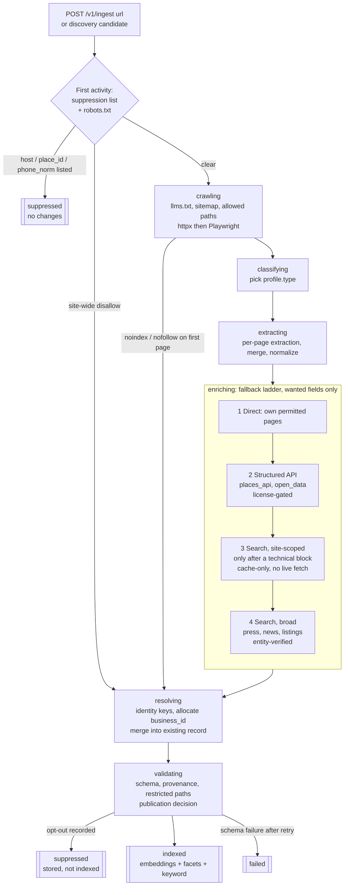
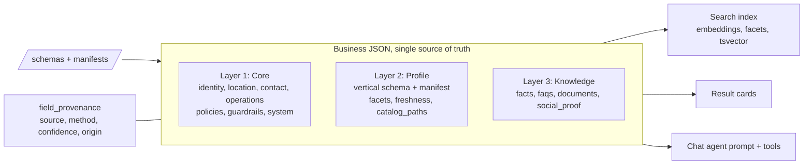
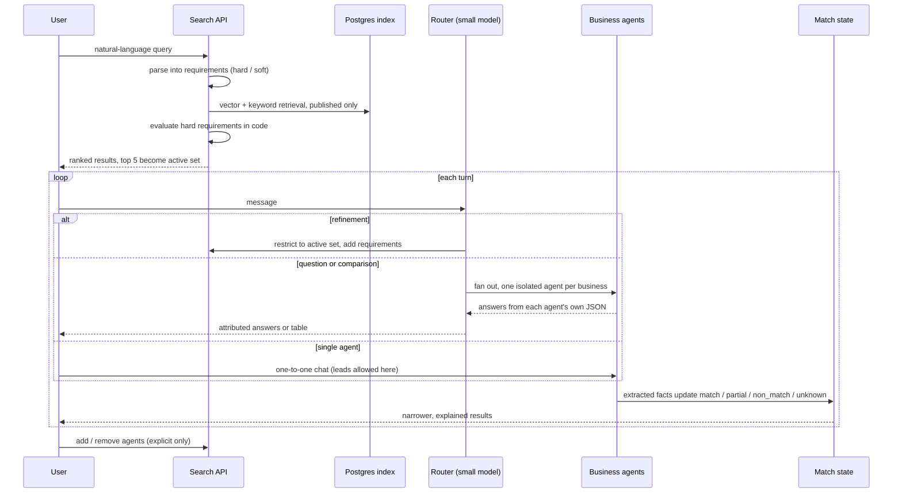
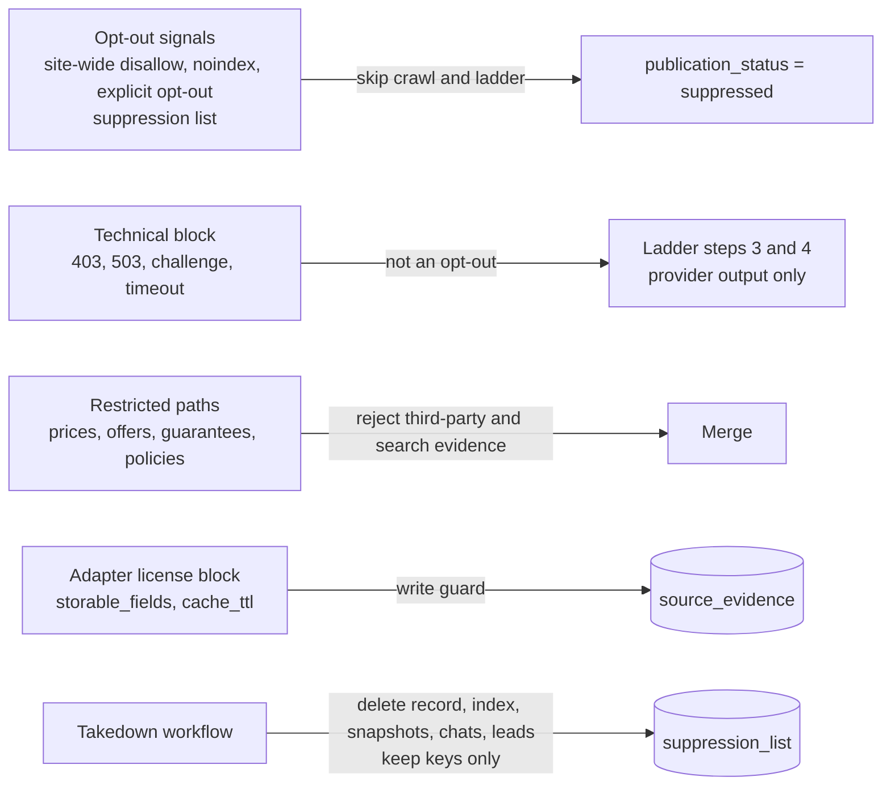

# Architecture

Derived from `SPEC.md`. Section numbers in brackets point back to the spec. The diagrams are Mermaid and render on GitHub.

## 1. System overview

```mermaid
flowchart LR
  subgraph Clients
    U[Public user<br/>search + chat UI<br/>Next.js, SSE]
    A[Admin<br/>ingest, discover, edit, takedown]
  end

  subgraph API["FastAPI (request path) [3, 6.1, 7, 8]"]
    S[Search<br/>POST /v1/search<br/>query understanding, retrieve, evaluate, rerank]
    C[Chat<br/>single-business + fan-out router<br/>capability registry, grounding check]
    AD[Admin API<br/>ingest, discover, refresh, PATCH, takedown]
  end

  subgraph TEMPORAL["Temporal workers [6.5]"]
    W1[ingest / discover<br/>refresh / reextract]
    W2[migrate / takedown<br/>lead delivery]
    BQ[Browser task queue<br/>Playwright crawl]
  end

  subgraph STORES[Data stores [9]]
    PG[(PostgreSQL 16<br/>businesses JSONB, pgvector, pg_trgm<br/>evidence, audit, sessions, leads)]
    TPG[(Temporal Postgres<br/>separate DB)]
    R[(Redis<br/>caches, rate limits)]
    OBJ[(S3 / MinIO<br/>page snapshots, PDFs<br/>pre-migration backups)]
  end

  subgraph EXT[External services]
    SITE[Business websites]
    PL[Places API]
    OD[Open data / OSM]
    GEO[Geocoder]
    SRCH[Search API<br/>Exa default, Tavily]
    LLM[LLMs<br/>Claude for extraction + chat<br/>small model for routing]
  end

  U --> S
  U --> C
  A --> AD
  AD -->|start workflows| W1
  AD --> PG
  S --> PG
  S --> R
  S --> LLM
  S --> GEO
  C --> PG
  C --> R
  C --> LLM
  W1 --> BQ
  BQ --> SITE
  W1 --> PL
  W1 --> OD
  W1 --> GEO
  W1 --> SRCH
  W1 --> LLM
  W1 --> PG
  W1 --> OBJ
  W2 --> PG
  W2 --> OBJ
  TEMPORAL --- TPG
```

## 2. Ingest pipeline and fallback ladder [5, 5.1, 6]



## 3. Business JSON: three layers [4]



## 4. Search, active set, and chat [7, 8]



## 5. Compliance guardrails [2, 5.1, 11]


